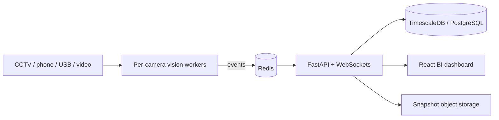

# RetailVision BI

RetailVision BI is a camera-informed business intelligence platform for QSR and
retail operations. The initial scaffold provides the API/auth foundation, a
responsive dashboard shell, and a Docker Compose development environment.
Computer-vision analytics and production data workflows are being added in
phases; the current dashboard uses clearly labeled sample metrics.

## Start the development stack

Prerequisites: Docker Desktop with Compose, or Python 3.11+ and Node.js 20+ for
running services individually.

```powershell
Copy-Item .env.example .env
# Set POSTGRES_PASSWORD and BOOTSTRAP_ADMIN_PASSWORD in .env before starting.
# Generate a PostgreSQL password with: python -c "import secrets; print(secrets.token_hex(24))"
docker compose up --build
```

Open the frontend at <http://localhost:5173>, the API docs at
<http://localhost:8000/docs>, and the health endpoint at
<http://localhost:8000/api/v1/health>. Set `APP_SECRET_KEY` to a unique random
value before using real data or exposing the stack. The API generates a
process-local development key if it is blank; tokens expire after 30 minutes
and become invalid when the API restarts.

## Architecture



The worker container is an idle health-checked process in this scaffold; camera
ingestion and event processing are later phases. The database and Redis
containers are provisioned now, with schema and aggregation work planned for
Phase 2.

## Repository map

- `backend/`: FastAPI application, security, worker entry point, migrations, tests.
- `frontend/`: React, TypeScript, Vite, Tailwind, and the dashboard shell.
- `infra/`: deployment configuration extensions.
- `docs/`: project brief, decisions, privacy and operator guidance.
- `scripts/`: development and operations scripts.

See [`PROJECT_BRIEF.md`](PROJECT_BRIEF.md) for product requirements and
[`DECISIONS.md`](DECISIONS.md) for implementation choices and phase boundaries.

## Development checks

```powershell
cd backend
python -m pip install -e ".[dev]"
python -m pytest
python -m ruff check .
python -m mypy src

cd ..\frontend
npm ci
npm run build
```

## Privacy and deployment

Customer imagery is not stored or used to identify customers. Staff identity
features must remain opt-in with recorded consent; customer demographics, if
later enabled, must be anonymous, aggregated, feature-flagged, and accompanied
by an accuracy disclaimer. Read [`PRIVACY.md`](PRIVACY.md) before connecting
cameras. Do not expose the development Compose ports to the public internet or
use the sample database password in production.
